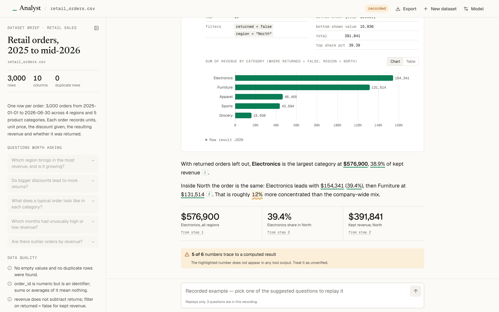
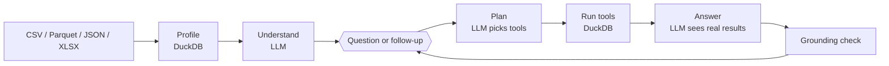

# Multi-agent data analyst

Give it a dataset. It works out what the data is, then answers your questions by running a fixed set of safe analysis tools. The reply can only quote numbers those tools computed, and a check flags any number it can't trace back.



## How it works



1. **Profile.** DuckDB loads the file and measures every column: type, nulls, distinct values, min/max/mean/median, top values and a small histogram.
2. **Understand.** One LLM call turns the profile into a short brief: what the dataset appears to be, what each column means, quality problems, and a few questions worth asking.
3. **Plan.** For each question, a planner LLM picks up to five calls from a fixed registry of eleven tools. It sees the schema, the brief and the last few turns. Tool names or arguments that don't fit the schema are dropped before anything runs.
4. **Run.** Each tool compiles to parameterised SQL with validated, quoted identifiers and returns rows, a chart spec and a few headline numbers.
5. **Answer.** A second LLM call gets the question and the actual tool results as JSON. It answers first, cites steps as `[1]`, `[2]` and says so when the data can't answer the question.
6. **Follow up.** The next question sees the previous turns, so you can change the analysis in place: "same but by month", "exclude the West region", "now compare returned vs not returned".

Every step streams to the browser over server-sent events. You can open any step to see its arguments, its chart and its raw result.

## Why the tools are a fixed list

The first version of this project ran `exec()` on whatever code was typed into a web form, so anyone with the URL could run code on the server. This version lets the model choose among eleven audited functions (`group_aggregate`, `time_trend`, `distribution`, `top_categories`, `correlation`, `outliers`, `compare_groups`, `crosstab`, `scatter`, `describe_column`, `filter_rows`), and no input from the model or the user is ever executed as code.

## Grounding check

After each answer, `analyst/grounding.py` pulls out every number in the text. It then looks for each one in the tool results and the profile, after rounding to two significant figures and treating 37% and 0.37 as the same number. Integers from 0 to 10, years, and numbers from your own question are left out. The UI shows "N of M numbers trace to a computed result" and highlights any that don't.

In the recorded example (`samples/retail_orders.cached.json`, "Where are we losing margin?", offline mode), 20 of 20 numbers trace to a computed result.

## Bring your own model

The LLM client speaks the OpenAI-compatible chat API, so any compatible provider works. Set it in `.env` or in the workspace's settings drawer:

| Variable | Default |
|---|---|
| `LLM_API_KEY` | falls back to `GROQ_API_KEY`, then `OPENAI_API_KEY` |
| `LLM_BASE_URL` | `https://api.groq.com/openai/v1` |
| `LLM_MODEL` | `openai/gpt-oss-120b` |

With no key, the app runs in **offline mode**. A keyword planner picks the tools, and the answer is a plain table of tool results marked "LLM not configured". It doesn't write prose it can't back up.

## Run it locally

Python 3.12+ and Node 22.

```bash
pip install -r requirements.txt
```

```bash
cp .env.example .env
```

```bash
cd web && npm install && npm run build && cd ..
```

```bash
uvicorn server.main:app --port 8000
```

Open http://localhost:8000. For frontend development, run `npm run dev` in `web/` (it proxies `/api` to port 8000).

## Tests

```bash
pytest -q
```

The tests cover the LLM wrapper, profiling, every tool (including SQL-injection attempts in filters), grounding, multi-turn sessions and the HTTP/SSE API. A fake LLM stands in for the provider, so the suite needs no network.

## Layout

```
analyst/   config, llm (the only file importing an SDK), data, tools, grounding, agents, session
server/    FastAPI app: REST + SSE, serves web/dist
web/       React + Vite frontend (landing page and /app workspace)
samples/   sample datasets, generator script, recorded example
tests/
```

## Limits

- Data is held in memory, and sessions sit in an in-process store that keeps the 20 most recent. Uploads are capped at 25 MB and tables at 200,000 rows by default (`MAX_UPLOAD_MB`, `MAX_ROWS`).
- One table per session; no joins across files.
- The grounding check confirms that a number exists in the results. It can't tell whether the sentence around it describes that number correctly, so the model can still word a finding badly.
- Free-tier LLM providers rate-limit. Every question uses two LLM calls (plan and answer), and the dataset brief uses one.

## Data sources

- **Palmer penguins**: Horst, Hill & Gorman (2020), the palmerpenguins package; data by Dr. Kristen Gorman and Palmer Station LTER. CC0.
- **Heart disease (excerpt)**: 65 rows of the UCI Heart Disease (Cleveland) data as redistributed on Kaggle.
- **Retail orders**: synthetic, generated by `samples/make_retail.py` (seed 7).
